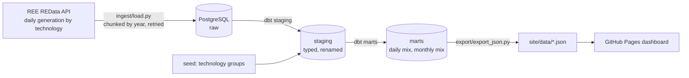

# Spain's electricity mix, day by day

[](https://github.com/itzi97/spain-electricity-pipeline/actions/workflows/pipeline.yml)

**Dashboard: [itzi97.github.io/spain-electricity-pipeline](https://itzi97.github.io/spain-electricity-pipeline/)**

A small, end-to-end data pipeline on open data. Every morning it pulls daily
generation by technology from Red Eléctrica's REData API, loads it into
PostgreSQL, models and tests it with dbt, and publishes a static dashboard
showing how much of Spain's electricity came from renewables.

The point is the boring, careful part: an idempotent loader that notices when
the source revises a figure, models with tests that would catch a missing
technology or a missing day, and a run that either passes all of that or does
not publish.

## How it fits together



Two ways to run it:

| | GitHub Actions (published) | Airflow (local) |
|---|---|---|
| Schedule | 08:17 Madrid, daily | 08:17 Madrid, daily |
| Database | fresh PostgreSQL service per run | persistent warehouse in Docker |
| Load window | full history since 2023 (about 22,000 rows, seconds) | last 14 days, where REE still revises |
| Output | dashboard on GitHub Pages | `site/data/` on disk |

## Layers

**Raw** (`ingest/schema.sql`). One row per technology per day exactly as REE
publishes it, keyed on `(technology_id, day)`. The loader upserts and only
touches a row when its value changed, and every run is recorded in
`raw.load_runs` with how many rows were new, revised or unchanged. Raw has no
range checks on purpose: it keeps what the source said, and dbt decides what is
acceptable.

**Staging** (`dbt/models/staging`). Renamed and typed. REE's own "Total
generation" row is kept and flagged so the marts can reconcile against it.

**Marts** (`dbt/models/marts`).

| Model | Grain | What it holds |
|---|---|---|
| `dim_technology` | technology | name, group (wind, solar, hydro, nuclear, combined cycle, coal, cogeneration, other) and renewable flag, from a seed |
| `fct_generation_daily` | day × technology | net generation in MWh and REE's share of the day |
| `mart_daily_mix` | day | total and renewable MWh, renewable share, trailing 7-day share, the largest source |
| `mart_monthly_mix` | month × group | net generation and share of the month |

The 7-day share is a ratio of sums (renewable MWh over total MWh across the
week), not an average of seven daily ratios, so a windy, low-demand Sunday does
not weigh as much as a busy weekday.

## Tests

`dbt build` runs 27 data tests between the models; the run stops before
publishing if any fails.

- **Every technology REE reports must be mapped.** A relationships test from
  staging to the seed. If REE starts publishing a new category, the run fails
  instead of the new rows quietly falling into no group.
- **Technologies add up to REE's reported total** for every day, within 0.1%.
- **No missing days** between the first and last loaded day, checked against a
  generated calendar. A gap would make the 7-day share average over fewer days.
- Uniqueness on every grain, not-null keys, accepted values for REE's renewable
  classes, shares between 0 and 1.
- **Negative net generation warns rather than fails.** See below.

Python tests (`pytest`) cover the client and the loader: splitting ranges by
calendar year, parsing across the clock change, retrying the API's temporary
errors, and, against a real PostgreSQL in a throwaway database, that a re-run
counts new, revised and unchanged rows correctly.

## Things the data taught me

- **Net generation can be negative.** On some days in November 2026, coal
  reported small negative values: a plant's own consumption exceeded its
  output. A `mwh >= 0` check in the raw table rejected the first load. It is
  now a dbt test with `severity: warn`, so the case is visible on every run
  without blocking it.
- **The API returns a day it was not asked for.** Requesting up to
  `2026-11-16T23:59` also returned 17 November, partially filled, because the
  end bound is read in a different time zone. The client now drops anything
  outside the requested range.
- **Recent days get revised.** Re-reading the last two weeks a few minutes
  after a full load updated five rows. That is why the loader upserts and
  counts revisions, and why the Airflow DAG re-reads 14 days rather than one.
- **The day is the local day.** Timestamps come as
  `2026-03-29T00:00:00.000+01:00`; converting to UTC first would shift every
  day back by one. The client takes the date as written, and a test covers the
  spring clock change.
- **Temporary unavailability comes back as HTTP 400**, not 503, so the client
  retries 400s too, with backoff.

## Running it

### Locally, without Docker

Needs Python 3.12+ and a PostgreSQL you can reach.

```bash
python -m venv .venv && . .venv/bin/activate
pip install -r requirements.txt
export PGHOST=localhost PGUSER=postgres PGPASSWORD=postgres PGDATABASE=grid

pytest -q
python -m ingest.load --start 2023-01-01
(cd dbt && dbt build --profiles-dir .)
python -m export.export_json --out site/data
python -m http.server -d site 8000      # then open http://localhost:8000
```

### With Airflow

```bash
docker compose up -d
docker compose logs airflow | grep -i password    # admin password for http://localhost:8080
```

Trigger `ree_daily` once with the config `{"start": "2023-01-01"}` to backfill;
after that the daily run re-reads the last 14 days. The warehouse is on
`localhost:5433` for `psql` or a BI tool.

## Layout

```
ingest/      REE client, loader and raw schema
dbt/         staging and mart models, seed, custom generic tests, singular tests
export/      marts to JSON for the dashboard
site/        the dashboard (one HTML file, no build step)
airflow/     DAG for the local, long-lived version
tests/       pytest: client and loader
```

## Data

[Red Eléctrica, REData API](https://www.ree.es/en/apidatos), endpoint
`generacion/estructura-generacion`, daily. National figures (peninsular and
non-peninsular systems combined), net generation in MWh. Recent figures are
provisional and REE revises them.

Built by Itziar Morales. MIT licence.
